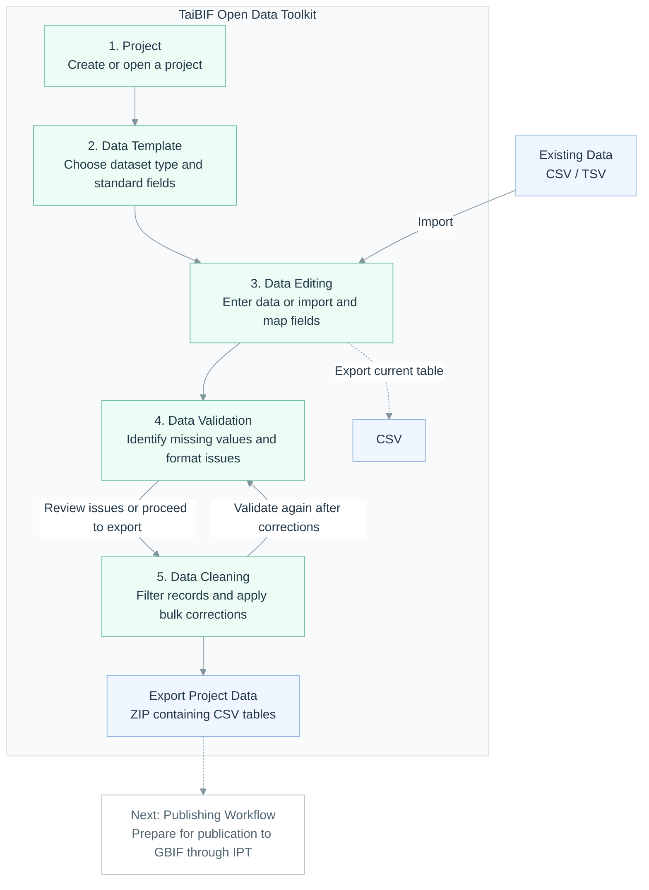
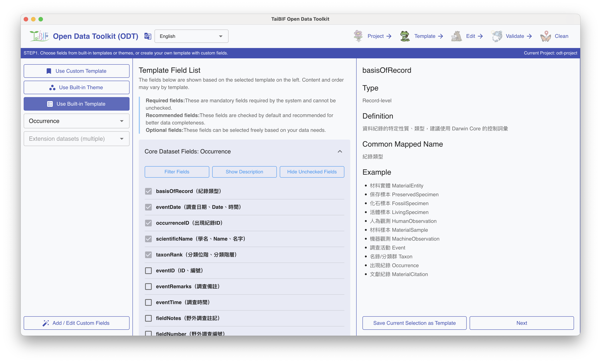
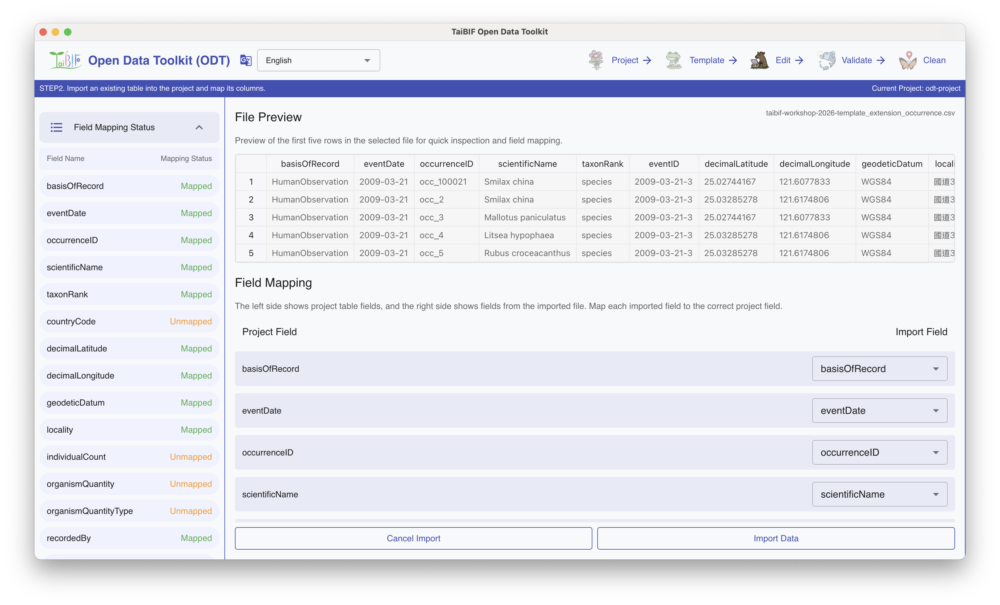
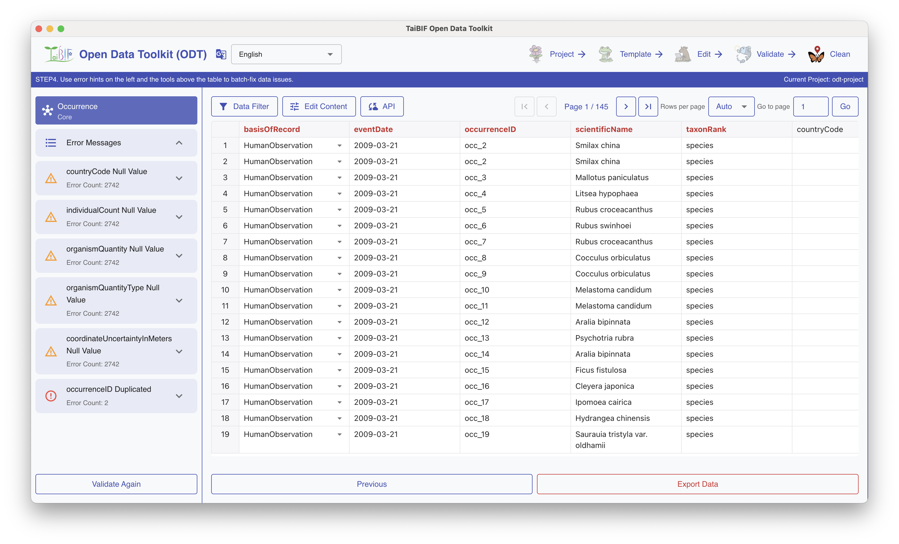

<div align="center">

# TaiBIF Open Data Toolkit

**Turn biodiversity spreadsheets into standardized data for sharing.**

A desktop toolkit for selecting Darwin Core fields, importing existing tables, checking data quality, and correcting inconsistent values—with a Mandarin-friendly interface.

Prepare your data for publishing workflows through IPT and GBIF.

**[Download](https://github.com/TaiBIF/taibif-open-data-toolkit/releases/latest) · [Quick Start](#quick-start) · [Workflow](#workflow)**

</div>

Developed by TaiBIF (Taiwan Biodiversity Information Facility). The toolkit is designed primarily for Mandarin-speaking users and also includes English and Spanish interface translations.


## Contents

- [Why Use This Toolkit?](#why-use-this-toolkit)
- [Workflow](#workflow)
- [Download](#download)
- [Quick Start](#quick-start)
- [Features](#features)
- [Input and Output](#input-and-output)
- [FAQ](#faq)
- [Development](#development)
- [Contact](#contact)
- [License](#license)

## Why Use This Toolkit?

Preparing biodiversity data for sharing often means translating local column names, checking required values, and correcting inconsistent entries across many records. Doing this manually in a spreadsheet can make it difficult to track which records still need attention.

TaiBIF Open Data Toolkit brings these tasks into a guided desktop workflow for researchers, collection managers, and biodiversity data providers. Templates use Darwin Core, a shared vocabulary for biodiversity data, to help structure your dataset for exchange and reuse.

| If you need to… | The toolkit helps you… |
|---|---|
| Decide which fields your dataset needs | Choose a template and review Darwin Core field descriptions |
| Reuse a table with different column names | Import CSV / TSV files and map columns to template fields |
| Find missing values and formatting issues | Validate data and locate records that need attention |
| Correct inconsistent values across many records | Filter data and apply bulk replacements |
| Prepare data for publication | Edit, validate, clean, and export data for the next stage |

## Workflow

Import an existing table or enter data directly. Validate your dataset, correct issues, and validate again before exporting. You can return to earlier steps to adjust your data or template.



Project data export is available from the Data Cleaning page. The toolkit prepares data; publication through IPT (Integrated Publishing Toolkit) and GBIF is a separate workflow.

## Download

Download the desktop application from the [GitHub Releases page](https://github.com/TaiBIF/taibif-open-data-toolkit/releases/latest). Choose an installer that matches your operating system and computer architecture from the files available in the release.

To use the packaged application, download an installer rather than the repository's source code archives. The development instructions below are for running the app from source.

## Quick Start

1. **Create a project.** Open the application and create a project for your dataset.
2. **Choose a template.** Select a Checklist, Occurrence, or Sampling Event template and choose the fields you need.
3. **Add your data.** Import a CSV / TSV file and map its columns to the selected template, or enter records directly in the table.
4. **Validate.** Review the reported issues and identify records that need attention.
5. **Clean and revalidate.** Filter affected records, apply corrections, and run validation again.
6. **Export.** Export the current table as CSV from Data Editing, or export the project's tables as a ZIP file from Data Cleaning.

If your data is in Excel, save the relevant worksheet as CSV or TSV before importing it.

<!-- TODO: Add a downloadable sample CSV and a walkthrough using the same sample as the screenshots. -->

## Features

### Build a Template for Your Dataset

Start with standard fields instead of designing your table from scratch.

- Choose templates for Checklist, Occurrence, and Sampling Event datasets.
- Review Darwin Core field descriptions and reference information while selecting fields.
- Add clearly labeled custom fields for project-specific needs.



### Bring Existing Tables into a Standard Structure

Reuse your existing data and map its columns to the selected template.

- Import CSV / TSV files and review mapped, unmapped, and duplicated fields.
- Edit records in a familiar spreadsheet-like interface, including adding and deleting blank rows.
- Review field value summaries to understand data distributions and spot inconsistent entries.



### Find Issues and Correct Data

Locate records that need attention and apply corrections across multiple rows.

- Check for missing required fields, field name mismatches, invalid dates and coordinates, identifier issues, and controlled vocabulary values. Review notices about empty optional fields and duplicated identifiers.
- Filter text using exact, fuzzy, or regular expression searches, and find duplicate values in selected fields.
- Apply string replacements, swap field values, or synchronize species information using the available cleaning tools.

For example, if a locality appears with different spellings, filter the relevant records and replace the variants with the value you choose. The standardization rule remains your decision.



## Input and Output

| Operation | Format | Result |
|---|---|---|
| Import existing data | CSV / TSV | Records mapped to fields in the selected project table |
| Export a table from Data Editing | CSV | The current table's column headers and records |
| Export project data from Data Cleaning | ZIP | One CSV file for each project table |

The ZIP export contains CSV tables named with the project name and internal table name. It does not include Darwin Core Archive descriptors such as `meta.xml` or dataset metadata such as `eml.xml`, so it is not a complete Darwin Core Archive. Complete the required mapping and metadata steps in your downstream publishing workflow.

## FAQ

### Do I need to know Darwin Core before using the toolkit?

You can start with the built-in templates and field descriptions. You will still need to choose fields that represent your data and review their meaning. Darwin Core is a standard vocabulary for sharing biodiversity information.

### Can I import Excel files?

The import workflow accepts CSV and TSV files. Save the worksheet you want to import in one of these formats first.

### Does the toolkit publish directly to GBIF?

The toolkit handles data preparation and export. Publishing through IPT and GBIF is a separate process that includes dataset mapping and metadata preparation.

### Does passing validation guarantee that my data is correct?

Validation checks the rules implemented by the toolkit. Review the scientific accuracy and context of your records as well; a correctly formatted value can still be inaccurate.

## Development

Node.js 22 is recommended, and npm 7 or later is required. After cloning the repository, install dependencies and start the development app:

```bash
npm ci
npm run start
```

Create a project and select a template before using the editing and cleaning tables.

See the [Development Guide](docs/development.md) for platform build tools, build and packaging commands, database behavior, native dependency troubleshooting, and project structure.

## Contact

For questions, collaboration, or feedback, contact the TaiBIF team via the [official contact form](https://portal.taibif.tw/zh-hant/contact-us).

## License

This project is released under the [MIT License](LICENSE).

This project is based on Electron React Boilerplate. See [NOTICE](NOTICE) for attribution information.
